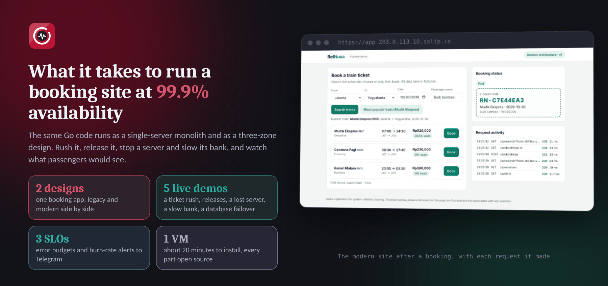
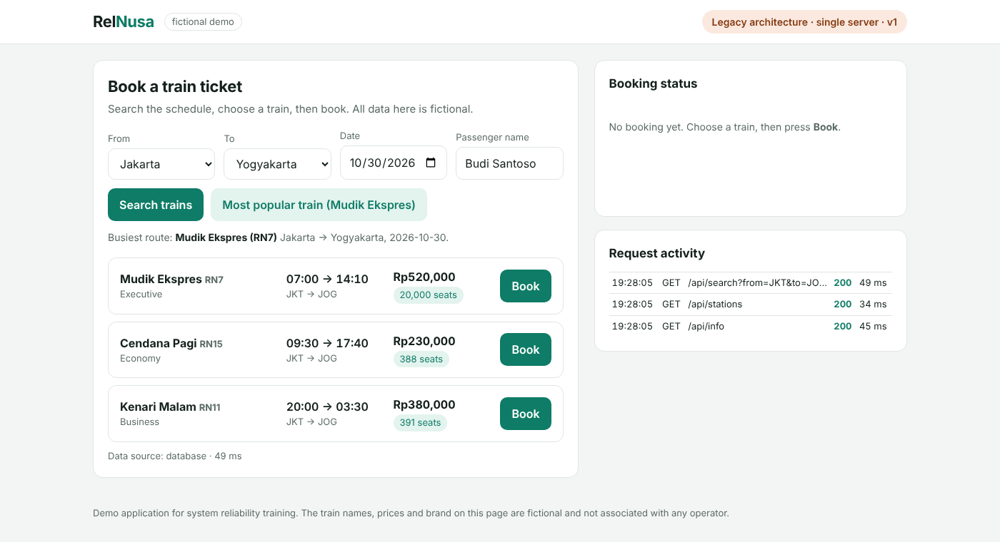
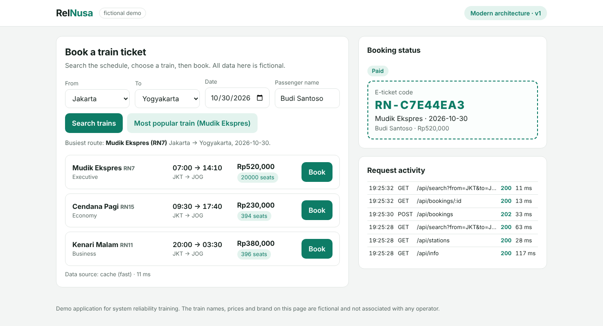
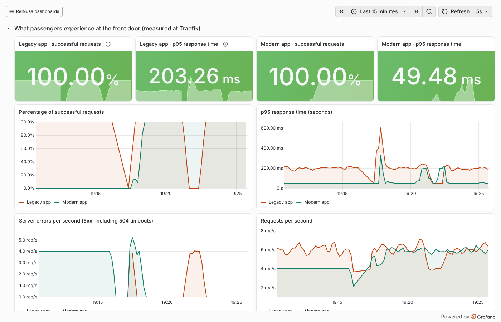
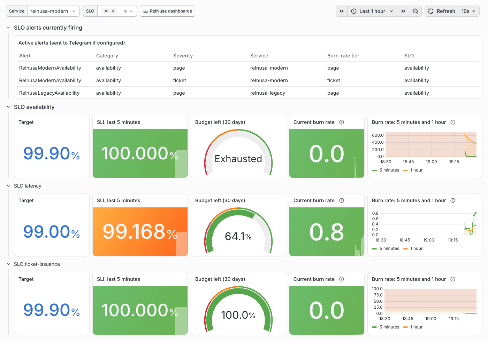
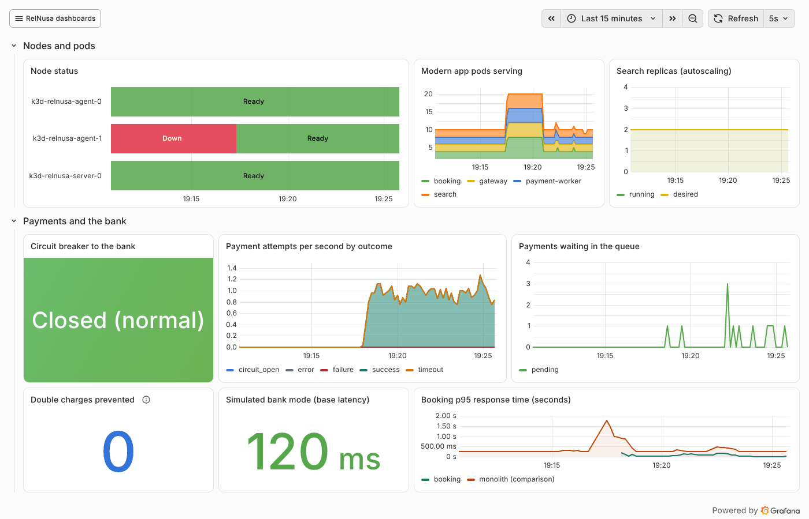

<p align="center">
  
</p>

<h1 align="center">RelNusa Availability Lab</h1>

<p align="center">
  <em>A fictional train-ticket site, built twice, with the tools that measure it, release it and break it.</em>
</p>

<p align="center">
  
  
  
  
  <br>
  
  
  
  
</p>

<p align="center">
  
</p>

<p align="center">
  <a href="#what-it-is">What it is</a> &middot;
  <a href="#how-it-works">How it works</a> &middot;
  <a href="#what-you-see">What you see</a> &middot;
  <a href="#try-it">Try it</a> &middot;
  <a href="#run-the-demos">Run the demos</a> &middot;
  <a href="#slos-and-alerts">SLOs</a> &middot;
  <a href="#for-your-team">For your team</a> &middot;
  <a href="#extend-it">Extend</a> &middot;
  <a href="#explore-the-code">Explore</a>
</p>

---

## What it is

This lab accompanies the session **Achieving 99.9% Availability and Beyond**. It runs a fictional train-ticket booking site called **RelNusa** in two architectures on one Linux machine: a legacy single-server monolith and a modern design spread over three zones. Both run the same Go program, so every difference you see comes from the design. Around them sit the tools that site reliability engineering (SRE) teams use to measure, alert, release safely and practice failures. Every component is open source, so you can reinstall it in your own data center, on VMware or in any cloud.

| Part | What runs | What it shows |
|---|---|---|
| Legacy system | One monolith process and one database on a single node | Common legacy patterns: database row locks held while calling the bank, no cache, no queue, no timeouts, deployments by stopping and restarting |
| Modern system | A gateway with a virtual waiting room, a search service with a cache, a booking service with a payment queue, a payment worker with a circuit breaker, and PostgreSQL with one primary, two replicas and automatic failover | Architecture patterns that raise availability |
| Operations | Prometheus, Grafana, Alertmanager (to Telegram), OpenTelemetry and Jaeger, SLOs and error budgets (Sloth), progressive delivery (Argo Rollouts), load testing (k6), failure experiments (Chaos Mesh) | How to measure, alert, release safely and practice handling failures |
| Simulated bank | A mock payment provider that can be made slow, error-prone or unavailable | An external dependency outside our control |

> RelNusa is a fictional application. Its train names, prices and brand are invented and do not represent any organization's systems.

Tested versions are pinned in `lab.sh` and the manifests: k3s 1.36.5 in k3d 5.8.3, the kube-prometheus-stack chart 91.9.0, CloudNativePG (chart 0.29.1) with PostgreSQL 17.10, Redis 7.4, Argo Rollouts (chart 2.43.2), Chaos Mesh (chart 2.8.4), the OpenTelemetry Collector 0.160.0, Jaeger 2.17.0, Sloth 0.16.0, k6 1.8.1 and Go 1.26.

## How it works

<p align="center">
  
</p>

Both sites sit behind the same Traefik ingress, so every request is measured at the same front door. The legacy site keeps everything on one node, which a demo stops on purpose. The modern site spreads the same work over three zones and adds four things:

- **A waiting room in front of booking.** The gateway admits about 120 bookings a second and gives everyone else a queue position, so a rush never reaches the database at full force.
- **Hold the seat first, pay afterwards.** Booking takes the seat in one SQL statement, puts the payment on a Redis stream and answers at once. A worker charges the bank with a timeout, a circuit breaker and an idempotency key.
- **Search that survives a slow database.** Search answers from a Redis cache, keeps an older copy for when the database is slow, and reads from replicas.
- **A database that fails over by itself.** PostgreSQL runs as one primary and two replicas under CloudNativePG, which promotes a replica when the primary fails.

The difference shows best in a single booking:

<p align="center">
  
</p>

Under a rush, the legacy design runs out of its 20 database connections while each one waits for the bank, and the search page stalls with them. The modern design holds the lock for one statement, so a slow bank only delays the e-ticket.

The operations tools are wired the way a production team would wire them:

<p align="center">
  
</p>

Grafana and the canary checks read the same Prometheus data as the alerts, so a release decision and a page rest on the same numbers.

## What you see

Everything below comes from a test run of the lab. The two sites need no login; Grafana is open for viewing.

<table>
  <tr>
    <td width="50%"></td>
    <td width="50%"></td>
  </tr>
  <tr>
    <td><b>The legacy site.</b> One process answers search and booking from the database; the request log on the right shows every call and its time.</td>
    <td><b>The modern site.</b> Search answers from the cache, the booking answers 202 at once and the e-ticket follows from the payment queue.</td>
  </tr>
  <tr>
    <td></td>
    <td></td>
  </tr>
  <tr>
    <td><b>RelNusa 1 &middot; Before vs after.</b> Both sites at the front door: successful requests, p95 response time, server errors and traffic.</td>
    <td><b>RelNusa 2 &middot; SLOs and error budgets.</b> Target, budget left and burn rate for each SLO, and the alerts on their way to Telegram; here after a round of demos.</td>
  </tr>
</table>

<p align="center">
  
  <br>
  <b>RelNusa 3 &middot; Inside the modern architecture.</b> Nodes, pods per service, autoscaling, the circuit breaker, payment outcomes and the queue; here just after a stopped node came back.
</p>

Also in the lab: Jaeger for traces, Argo Rollouts for releases, Chaos Mesh for failure experiments, Prometheus and Alertmanager. They sit behind one login at `https://<tool>.<ip>.sslip.io`, and `./lab.sh info` prints every address with the password.

## Try it

You need one Ubuntu 22.04 or 24.04 VM with 8 vCPUs, 32 GB of RAM and a 100 GB disk (4 vCPUs and 16 GB for the `small` profile), with TCP 80 and 443 open.

<p align="center">
  
</p>

In one go (the same line works as *user data* on AWS or as a *startup script* on Google Cloud):

```bash
curl -fsSL https://raw.githubusercontent.com/adamnugraha/kai-workshop/main/bootstrap.sh | sudo bash
```

Or step by step:

```bash
git clone https://github.com/adamnugraha/kai-workshop.git && cd kai-workshop
cp lab.env.example lab.env     # choose LAB_ACCESS, the Telegram token, the small profile
sudo ./lab.sh install-deps     # Docker, k3d, kubectl, helm, kubectl plugins
./lab.sh up                    # 15 to 25 minutes on the first install
./lab.sh info                  # addresses and the password
```

In the default `public` mode, every address uses the VM's public IP through [sslip.io](https://sslip.io), with free HTTPS certificates from Let's Encrypt, so there is no DNS to set up:

| Address | Contents | Login |
|---|---|---|
| `https://legacy.<ip>.sslip.io` | The legacy site | Not needed |
| `https://app.<ip>.sslip.io` | The modern site | Not needed |
| `https://grafana.<ip>.sslip.io` | Dashboards | View without logging in; edit as `admin` |
| `https://jaeger.<ip>.sslip.io`, `chaos.`, `rollouts.`, `prometheus.`, `alertmanager.` | Operator tools | `admin` and the password from `./lab.sh info` |

| Read next | For |
|---|---|
| [docs/install.md](docs/install.md) | Requirements, the SSH tunnel mode for servers without a public IP, updates, certificates and everyday commands |
| [docs/aws-setup.md](docs/aws-setup.md), [docs/gcp-setup.md](docs/gcp-setup.md), [docs/server-setup.md](docs/server-setup.md) | Step by step on AWS, on Google Cloud or on your own server |
| [docs/telegram-setup.md](docs/telegram-setup.md) | Alerts in a Telegram group, for you or for the whole audience |

## Run the demos

| Demo | Command | What you see |
|---|---|---|
| 1 &middot; Ticket rush | `./lab.sh spike legacy`, then `./lab.sh spike modern` | Legacy: response times climb to 10 seconds or more, 504 errors appear, and the whole site slows down, search included. Modern: no errors; buyers above capacity wait in the virtual queue and search adds replicas |
| 2 &middot; Releases | `./lab.sh legacy-deploy`, then `./lab.sh release good` and `./lab.sh release bad` | The legacy site is down for about 15 seconds. The modern canary moves step by step with no errors, and the analysis stops the buggy version before most users see it |
| 3 &middot; A lost server | `./lab.sh node-down`, later `./lab.sh node-up` | The zone-b node stops: the legacy site goes down completely and the modern site keeps serving |
| 4 &middot; Game day: a slow bank | `./lab.sh chaos bank-slow`, then `./lab.sh chaos stop` | The circuit breaker opens, seats can still be held, and the ticket issuance SLO alert reaches Telegram |
| 5 &middot; Database failover | `./lab.sh chaos kill-db-primary`, then `./lab.sh chaos stop` | A replica becomes the primary within seconds; search keeps working from the cache |

Between rounds, `./lab.sh reset` clears bookings, refills seats and puts the bank back to normal. Before going on stage, `./lab.sh preflight` checks everything at once; `./lab.sh help` lists every command. Demo 4 needs the `netem` kernel module on the VM; without it, `./lab.sh bank slow` gives the same fault inside the bank. The presenter's steps for all five demos, with what to point at and what to do when something goes wrong, are in [demos/RUNBOOK.md](demos/RUNBOOK.md).

## SLOs and alerts

| Service | SLO | Target | Measured at |
|---|---|---|---|
| relnusa-modern, relnusa-legacy | Availability: requests without a server error | 99.9% | Traefik (the user's side) |
| relnusa-modern, relnusa-legacy | Latency: requests under 500 ms | 99% | Traefik |
| relnusa-modern | Ticket issuance: payment attempts that succeed | 99.9% | Payment worker |

The definitions are in [`k8s/slo/relnusa-slos.yaml`](k8s/slo/relnusa-slos.yaml). Sloth turns them into the Prometheus rules in `k8s/slo/rules/`, including the multi-window, multi-burn-rate alerts described in Google's Site Reliability Workbook. Only alerts that belong to an SLO reach Telegram; every other alert stays on the dashboards.

## For your team

### Templates

The [templates/](templates/README.md) folder holds plain Markdown templates, easy to copy into Confluence, SharePoint, Notion or a Git wiki. The examples use RelNusa; replace them with your own services.

| Template | Use it for |
|---|---|
| [System design worksheet](templates/system-design-worksheet.md) | Targets per journey, availability chain math, failure domains, busiest-minute capacity and the design review questions |
| [SLO worksheet](templates/slo-worksheet.md) | SLIs, SLOs, error budgets and alert thresholds from one user journey |
| [Error budget policy](templates/error-budget-policy.md) | Release rules agreed by the business and IT for when the budget runs low |
| [Severity matrix](templates/severity-matrix.md) | Incident levels, roles, response targets and communication |
| [Alert runbook](templates/alert-runbook.md) | Diagnosis and recovery steps for one alert |
| [Postmortem](templates/postmortem.md) | Blameless incident reports with measurable follow-up |
| [Game day plan](templates/game-day-plan.md) | Planned, safe failure drills |
| [Modernization scorecard](templates/modernization-scorecard.md) | Choosing the first function to separate from a monolith |
| [90-day plan](templates/90-day-plan.md) | The first 30, 60 and 90 days of an SRE practice |

### From the lab to production

| In the lab | Production equivalent |
|---|---|
| k3d on one VM | A Kubernetes cluster across several servers or zones (Rancher, OpenShift, EKS, GKE, AKS) |
| CloudNativePG | The same operator in production, or a managed database service with replicas across zones |
| A single Redis instance | Redis with replication (Sentinel or cluster mode), or a managed service |
| Waiting room in the gateway | A virtual waiting room in the CDN or API gateway |
| Simulated bank | Real payment partners; the timeout, circuit breaker and idempotency key patterns stay the same |
| Telegram | The team's on-call channel (Telegram, Slack, PagerDuty, Opsgenie) |

## Extend it

Most changes are one line in a manifest or one new file, applied with a single `lab.sh` command. Each row links to step-by-step instructions in [docs/extending.md](docs/extending.md).

| You want to | Change | Guide |
|---|---|---|
| Let more or fewer bookings through the waiting room | `ADMIT_RATE` in `k8s/apps/modern.yaml` | [Waiting room](docs/extending.md#change-how-many-bookings-the-waiting-room-admits) |
| Change the bank timeout, worker concurrency or breaker | the `payment-worker` settings in `k8s/apps/modern.yaml` | [Payment worker](docs/extending.md#tune-the-payment-worker) |
| Change the canary steps or the error threshold | `k8s/apps/booking-rollout.tpl.yaml` | [Canary release](docs/extending.md#change-the-canary-release) |
| Add or change an SLO | `k8s/slo/relnusa-slos.yaml`, then Sloth | [SLOs](docs/extending.md#add-or-change-an-slo) |
| Add a dashboard panel | `tools/make_dashboards.py` | [Dashboards](docs/extending.md#add-a-dashboard-panel) |
| Add a failure experiment | a new file in `chaos/` | [Experiments](docs/extending.md#add-a-failure-experiment) |
| Change the ticket rush or add a load scenario | `./lab.sh spike` options, or `load/` | [Load](docs/extending.md#change-the-ticket-rush-or-add-a-load-scenario) |
| Send alerts to Slack, e-mail or a pager | `alertmanager_values` in `lab.sh` | [Alerts](docs/extending.md#send-alerts-to-another-channel) |
| Change the application or the bank | `app/`, then `./lab.sh rebuild` | [Application](docs/extending.md#change-the-application) |

## Explore the code

| Start here | To understand |
|---|---|
| [`app/internal/store/store.go`](app/internal/store/store.go) | `BookLegacy` and `Hold`: the two ways to take a seat |
| [`app/internal/modes/gateway.go`](app/internal/modes/gateway.go) | The virtual waiting room |
| [`app/internal/modes/search.go`](app/internal/modes/search.go) | Search with a cache, a stale copy and a circuit breaker |
| [`app/internal/modes/payment.go`](app/internal/modes/payment.go) | The payment worker: queue, timeout, breaker and retries |
| [`app/internal/obs/obs.go`](app/internal/obs/obs.go) | The metrics, traces, logs and health checks every role gets |
| [`k8s/apps/booking-rollout.tpl.yaml`](k8s/apps/booking-rollout.tpl.yaml) | The canary release and its analysis |
| [`k8s/slo/relnusa-slos.yaml`](k8s/slo/relnusa-slos.yaml) | The three SLOs |
| [`lab.sh`](lab.sh) | Installing the lab and running every demo |

```text
app/            application code (Go), one image for every role
k8s/cluster/    Traefik ingress settings
k8s/platform/   Helm values for monitoring, database, chaos and releases; collector and Jaeger
k8s/apps/       simulated bank, legacy system, modern system, metric monitors
k8s/slo/        SLO definitions and the generated Prometheus rules
k8s/dashboards/ Grafana dashboards (generated by tools/make_dashboards.py)
load/           k6 scripts: everyday traffic and the ticket rush
chaos/          Chaos Mesh experiments
demos/          the presenter's demo runbook
docs/           install, cloud and Telegram guides, the extension guide, and the figures on this page
templates/      templates for system design, SLOs, error budgets, incidents, postmortems, game days and modernization
lab.sh          a single entry point to install the lab and run the demos
```

Run the unit tests with `cd app && go test ./...`. The figures on this page are drawn from HTML in [`docs/assets/src/`](docs/assets/src); `node docs/assets/src/render.js` redraws them.

## License

Apache License 2.0. See [LICENSE](LICENSE).
