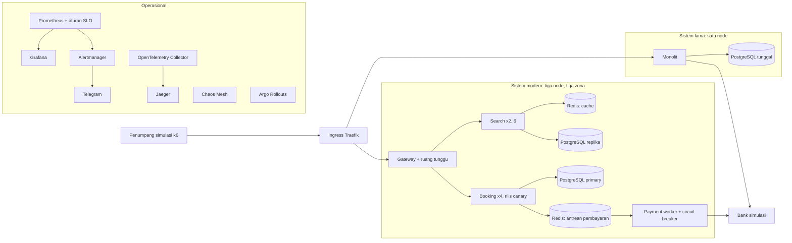

# Lab Ketersediaan RelNusa

Lab ini dipakai untuk sesi **Mencapai ketersediaan 99,9% ke atas**. Isinya satu aplikasi pemesanan tiket kereta fiktif bernama **RelNusa** dalam dua arsitektur, ditambah perangkat operasional yang biasa dipakai tim *site reliability engineering* (SRE). Semua komponen bersifat open source dan berjalan di satu mesin Linux, sehingga bisa dipasang ulang di pusat data sendiri, di VMware, atau di cloud mana pun.

> RelNusa adalah aplikasi fiktif. Nama kereta, harga dan mereknya rekaan dan tidak mewakili sistem milik organisasi mana pun.

## Isi lab

| Bagian | Isi | Yang ingin ditunjukkan |
|---|---|---|
| Sistem lama | Satu proses monolit dan satu database di satu node | Pola umum sistem lama: kunci baris database ditahan selama memanggil bank, tanpa cache, tanpa antrean, tanpa batas waktu, deploy dengan cara hentikan lalu jalankan |
| Sistem modern | Gateway dengan ruang tunggu virtual, layanan pencarian dengan cache, layanan pemesanan dengan antrean pembayaran, worker pembayaran dengan circuit breaker, PostgreSQL satu primary dan dua replika dengan failover otomatis | Pola arsitektur yang menaikkan ketersediaan |
| Operasional | Prometheus, Grafana, Alertmanager (ke Telegram), OpenTelemetry dan Jaeger, SLO dan error budget (Sloth), rilis bertahap (Argo Rollouts), uji lonjakan (k6), eksperimen kegagalan (Chaos Mesh) | Cara mengukur, memberi peringatan, merilis dengan aman dan berlatih menghadapi gangguan |
| Bank simulasi | Penyedia pembayaran tiruan yang bisa dibuat lambat, sering gagal atau mati | Ketergantungan eksternal yang tidak bisa kita kendalikan |

## Arsitektur



Lab berjalan di Kubernetes ringan (k3s di dalam Docker lewat k3d) dengan tiga node yang diberi label zona-a, zona-b dan zona-c. Komponen platform berada di node zona-a, yang tidak pernah dimatikan dalam demo. Sistem lama sengaja ditempatkan seluruhnya di node zona-b.

## Kebutuhan

- Satu VM Ubuntu 22.04 atau 24.04, 8 vCPU, 32 GB RAM, disk 100 GB (minimum 4 vCPU dan 16 GB untuk profil `small`)
- Akses internet keluar ke Docker Hub, GitHub, ghcr.io, quay.io dan registry.k8s.io
- Akses masuk: SSH, ditambah TCP 80 bila lab dibuka lewat IP publik (mode `public`, bawaan untuk VM di cloud)
- Port 80 (dan 9090 di 127.0.0.1) harus kosong; bila sudah terpakai, ubah `HTTP_PORT` dan `PROM_PORT` di `lab.env` sebelum memasang

Panduan langkah demi langkah: [AWS](docs/aws-setup.md), [Google Cloud](docs/gcp-setup.md), [server sendiri](docs/server-setup.md), dan [peringatan Telegram](docs/telegram-setup.md).

## Cara memasang

Sekaligus dari VM baru (dipakai juga sebagai *user data* di AWS atau *startup script* di GCP):

```bash
curl -fsSL https://raw.githubusercontent.com/adamnugraha/kai-workshop/main/bootstrap.sh | sudo bash
```

Atau langkah demi langkah:

```bash
git clone https://github.com/adamnugraha/kai-workshop.git
cd kai-workshop
cp lab.env.example lab.env     # pilih LAB_ACCESS, token Telegram, profil small
sudo ./lab.sh install-deps     # Docker, k3d, kubectl, helm, plugin kubectl
./lab.sh up                    # 15 sampai 25 menit pada pemasangan pertama
./lab.sh info                  # alamat dan kata sandi
```

## Cara mengakses

Ada dua mode, dipilih dengan `LAB_ACCESS` di `lab.env` sebelum `./lab.sh up`.

**Mode `public`** (bawaan untuk pemasangan lewat `bootstrap.sh`): semua alamat memakai IP publik VM melalui layanan DNS gratis [sslip.io](https://sslip.io), jadi tidak perlu mengatur DNS atau SSH tunnel. Buka TCP 80 di firewall.

| Alamat | Isi | Login |
|---|---|---|
| `http://legacy.<ip>.sslip.io` | Situs sistem lama | Tidak perlu |
| `http://app.<ip>.sslip.io` | Situs sistem modern | Tidak perlu |
| `http://grafana.<ip>.sslip.io` | Dasbor | Melihat tanpa login; mengubah sebagai `admin` |
| `http://jaeger.<ip>.sslip.io`, `chaos.`, `rollouts.`, `prometheus.`, `alertmanager.` | Alat operator | `admin` dan kata sandi dari `./lab.sh info` |

Alamat persisnya ditampilkan oleh `./lab.sh info`. Bila IP berubah setelah VM dimatikan dan dinyalakan, nama-nama itu ikut berubah dengan sendirinya. Untuk alamat yang tetap, pakai Elastic IP (AWS) atau IP statis (GCP), atau domain sendiri lewat `LAB_DOMAIN`.

**Mode `tunnel`**: semua hanya terbuka di 127.0.0.1 pada VM, cocok untuk server tanpa IP publik. Dari laptop:

```bash
ssh -N -L 8080:127.0.0.1:80 ubuntu@ALAMAT-VM
```

Lalu buka `http://app.localhost:8080`, `http://grafana.localhost:8080` dan seterusnya di Chrome atau Edge (keduanya mengenali `*.localhost` tanpa pengaturan DNS).

## Skenario demo

| Perintah | Yang terjadi | Yang terlihat |
|---|---|---|
| `./lab.sh spike legacy` | Lonjakan pembeli tiket ke sistem lama | Waktu respons naik ke belasan detik, error 504, seluruh situs ikut lambat termasuk pencarian |
| `./lab.sh spike modern` | Lonjakan yang sama ke sistem modern | Tanpa error; pembeli di atas kapasitas masuk antrean virtual; search bertambah replika |
| `./lab.sh legacy-deploy` | Deploy monolit dengan cara hentikan lalu jalankan | Situs lama mati sekitar 15 detik |
| `./lab.sh release good` | Rilis canary booking v2 | Argo Rollouts menaikkan versi baru bertahap tanpa error |
| `./lab.sh release bad` | Rilis canary booking dengan bug | Analisis Prometheus menghentikan rilis otomatis; sebagian besar pengguna tidak terdampak |
| `./lab.sh node-down` | Satu node (zona-b) dimatikan | Sistem lama mati total; sistem modern tetap melayani |
| `./lab.sh chaos bank-lambat` | Bank diberi jeda jaringan 3 detik (butuh modul kernel netem; bila tidak ada, pakai `./lab.sh bank slow`) | Circuit breaker terbuka, kursi tetap bisa dikunci, alert SLO penerbitan tiket menyala dan terkirim ke Telegram |
| `./lab.sh chaos matikan-db-primary` | Primary PostgreSQL dimatikan | Replika naik menjadi primary dalam hitungan detik; pencarian tetap jalan dari cache |
| `./lab.sh reset` | Mengosongkan pemesanan dan mengisi ulang kursi | Siap untuk putaran demo berikutnya |

Daftar lengkap ada di `./lab.sh help`. Sebelum demo, jalankan `./lab.sh preflight` untuk memeriksa semuanya sekaligus. Langkah demo untuk pembicara ada di [demos/RUNBOOK.md](demos/RUNBOOK.md) (bahasa Inggris).

## Templat untuk tim

Folder [templates/](templates/README.md) berisi templat yang bisa langsung dipakai: lembar kerja SLO, kebijakan error budget, matriks tingkat keparahan, runbook peringatan, postmortem, rencana game day, kartu penilaian modernisasi dan rencana 90 hari.

## SLO yang dipakai

| Layanan | SLO | Target | Diukur di |
|---|---|---|---|
| relnusa-modern, relnusa-legacy | Ketersediaan: permintaan tanpa error server | 99,9% | Traefik (sisi pengguna) |
| relnusa-modern, relnusa-legacy | Latensi: permintaan di bawah 500 ms | 99% | Traefik |
| relnusa-modern | Penerbitan tiket: upaya pembayaran yang berhasil | 99,9% | Payment worker |

Definisi ada di `k8s/slo/relnusa-slos.yaml`. Aturan Prometheus dibuat dengan `k8s/slo/generate.sh` (alat Sloth), termasuk alert *multi-window multi-burn-rate* sesuai SRE Workbook dari Google.

## Struktur repositori

```
app/            kode aplikasi (Go), satu image untuk semua peran
k8s/cluster/    pengaturan ingress Traefik
k8s/platform/   nilai Helm untuk monitoring, database, chaos, rilis; collector dan Jaeger
k8s/apps/       bank simulasi, sistem lama, sistem modern, monitor metrik
k8s/slo/        definisi SLO dan aturan Prometheus hasil generate
k8s/dashboards/ dasbor Grafana (dibuat oleh tools/make_dashboards.py)
load/           skrip k6: lalu lintas harian dan "war tiket"
chaos/          eksperimen Chaos Mesh
demos/          runbook demo untuk pembicara
docs/           panduan memasang di AWS, GCP atau server sendiri, dan menyiapkan Telegram
templates/      templat SLO, error budget, insiden, postmortem, game day dan modernisasi
lab.sh          satu pintu untuk memasang dan menjalankan demo
```

## Membawa pola ini ke sistem sendiri

| Di lab | Padanan di produksi |
|---|---|
| k3d di satu VM | Cluster Kubernetes di beberapa server atau zona (Rancher, OpenShift, EKS, GKE, AKS) |
| CloudNativePG | Operator yang sama di produksi, atau layanan database terkelola dengan replika lintas zona |
| Redis satu instance | Redis dengan replikasi (Sentinel atau cluster), atau layanan terkelola |
| Ruang tunggu di gateway | Virtual waiting room di CDN atau API gateway |
| Bank simulasi | Mitra pembayaran nyata; pola timeout, circuit breaker dan kunci idempotensi tetap sama |
| Telegram | Kanal on-call tim (Telegram, Slack, PagerDuty, Opsgenie) |

## Catatan

- Lab dibuat untuk pelatihan. Di mode `public` lalu lintas memakai HTTP biasa tanpa enkripsi; alat operator dilindungi login sederhana, dan tidak ada data nyata di dalam lab. Hapus VM setelah acara.
- Angka kinerja di lab bergantung pada ukuran VM dan tidak bisa langsung dibandingkan dengan sistem produksi mana pun.

## Lisensi

Apache License 2.0.
