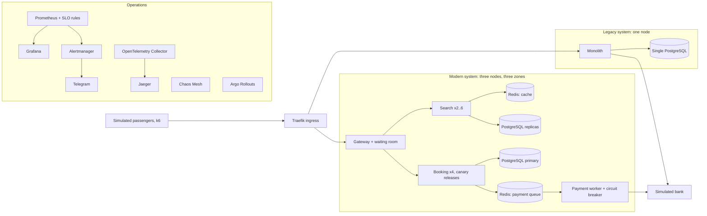

# RelNusa Availability Lab

This lab accompanies the session **Achieving 99.9% Availability and Beyond**. It contains a fictional train-ticket booking application called **RelNusa** in two architectures, plus the operational tooling that site reliability engineering (SRE) teams commonly use. Every component is open source and runs on a single Linux machine, so you can reinstall it in your own data center, on VMware or in any cloud.

> RelNusa is a fictional application. Its train names, prices and brand are invented and do not represent any organization's systems.

## What is in the lab

| Part | Contents | What it shows |
|---|---|---|
| Legacy system | One monolith process and one database on a single node | Common legacy patterns: database row locks held while calling the bank, no cache, no queue, no timeouts, deployments by stopping and restarting |
| Modern system | A gateway with a virtual waiting room, a search service with a cache, a booking service with a payment queue, a payment worker with a circuit breaker, and PostgreSQL with one primary and two replicas and automatic failover | Architecture patterns that raise availability |
| Operations | Prometheus, Grafana, Alertmanager (to Telegram), OpenTelemetry and Jaeger, SLOs and error budgets (Sloth), progressive delivery (Argo Rollouts), load testing (k6), failure experiments (Chaos Mesh) | How to measure, alert, release safely and practice handling failures |
| Simulated bank | A mock payment provider that can be made slow, error-prone or unavailable | An external dependency outside our control |

## Architecture



The lab runs on lightweight Kubernetes (k3s inside Docker, via k3d) with three nodes labeled zone-a, zone-b and zone-c. The platform components run on the zone-a node, which the demos never stop. The whole legacy system is deliberately placed on the zone-b node.

## Requirements

- One Ubuntu 22.04 or 24.04 VM with 8 vCPUs, 32 GB of RAM and a 100 GB disk (at least 4 vCPUs and 16 GB for the `small` profile)
- Outbound internet access to Docker Hub, GitHub, ghcr.io, quay.io and registry.k8s.io
- Inbound access: SSH, plus TCP 80 and 443 when the lab is opened on the public IP (`public` mode, the default for cloud VMs)
- Ports 80 and 443 (and 9090 on 127.0.0.1) must be free; if 80 or 9090 is already in use, change `HTTP_PORT` and `PROM_PORT` in `lab.env` before installing (HTTPS is only enabled when the lab uses port 80)

Step-by-step guides: [AWS](docs/aws-setup.md), [Google Cloud](docs/gcp-setup.md), [your own server](docs/server-setup.md) and [Telegram alerts](docs/telegram-setup.md).

## Installing

In one go on a new VM (also used as *user data* on AWS or a *startup script* on GCP):

```bash
curl -fsSL https://raw.githubusercontent.com/adamnugraha/kai-workshop/main/bootstrap.sh | sudo bash
```

Or step by step:

```bash
git clone https://github.com/adamnugraha/kai-workshop.git
cd kai-workshop
cp lab.env.example lab.env     # choose LAB_ACCESS, the Telegram token, the small profile
sudo ./lab.sh install-deps     # Docker, k3d, kubectl, helm, kubectl plugins
./lab.sh up                    # 15 to 25 minutes on the first install
./lab.sh info                  # addresses and the password
```

To update an installed lab to the latest version of this repository (data and releases are kept):

```bash
./lab.sh update
```

Older copies that do not have the `update` command yet only need to run `sudo git pull && ./lab.sh apply` once.

## Accessing the lab

There are two modes, chosen with `LAB_ACCESS` in `lab.env` before `./lab.sh up`.

**`public` mode** (the default when installing with `bootstrap.sh`): every address uses the VM's public IP through the free DNS service [sslip.io](https://sslip.io), so there is no DNS or SSH tunnel to set up. The lab requests free HTTPS certificates from Let's Encrypt for every address, so `https://` works right away; `http://` keeps working too. Open TCP 80 and 443 in the firewall (Let's Encrypt checks every name over port 80).

| Address | Contents | Login |
|---|---|---|
| `https://legacy.<ip>.sslip.io` | Legacy system site | Not needed |
| `https://app.<ip>.sslip.io` | Modern system site | Not needed |
| `https://grafana.<ip>.sslip.io` | Dashboards | View without logging in; edit as `admin` |
| `https://jaeger.<ip>.sslip.io`, `chaos.`, `rollouts.`, `prometheus.`, `alertmanager.` | Operator tools | `admin` and the password from `./lab.sh info` |

`./lab.sh info` shows the exact addresses. If the certificates have not been issued yet (for example because port 80 or 443 is still closed), `./lab.sh info` shows `http://` addresses and `./lab.sh preflight` explains why. To turn HTTPS off, set `LAB_HTTPS=off` in `lab.env` and run `./lab.sh apply`.

If the IP changes after the VM is stopped and started, these names follow it automatically, certificates included. For fixed addresses, use an Elastic IP (AWS), a static IP (GCP) or your own domain through `LAB_DOMAIN`.

**`tunnel` mode**: everything listens only on 127.0.0.1 on the VM, which suits servers without a public IP. From your laptop:

```bash
ssh -N -L 8080:127.0.0.1:80 ubuntu@VM-ADDRESS
```

Then open `http://app.localhost:8080`, `http://grafana.localhost:8080` and so on in Chrome or Edge (both resolve `*.localhost` without any DNS setup).

## Demo scenarios

| Command | What happens | What you see |
|---|---|---|
| `./lab.sh spike legacy` | A rush of ticket buyers hits the legacy system | Response times climb to 10 seconds or more, 504 errors appear, and the whole site slows down, search included |
| `./lab.sh spike modern` | The same rush hits the modern system | No errors; buyers above capacity wait in the virtual queue; search adds replicas |
| `./lab.sh legacy-deploy` | The monolith is deployed by stopping and restarting it | The legacy site is down for about 15 seconds |
| `./lab.sh release good` | Canary release of booking v2 | Argo Rollouts shifts traffic to the new version step by step, with no errors |
| `./lab.sh release bad` | Canary release of a booking version with a bug | Prometheus analysis stops the release automatically; most users are not affected |
| `./lab.sh node-down` | One node (zone-b) is shut down | The legacy system goes down completely; the modern system keeps serving |
| `./lab.sh chaos bank-slow` | The bank gets 3 seconds of network delay (needs the netem kernel module; without it, use `./lab.sh bank slow`) | The circuit breaker opens, seats can still be locked, and the ticket issuance SLO alert fires and reaches Telegram |
| `./lab.sh chaos kill-db-primary` | The PostgreSQL primary is killed | A replica is promoted to primary within seconds; search keeps working from the cache |
| `./lab.sh reset` | Clears bookings and refills seats | Ready for the next demo round |

`./lab.sh help` lists every command. Before a demo, run `./lab.sh preflight` to check everything at once. The speaker's demo steps are in [demos/RUNBOOK.md](demos/RUNBOOK.md).

## Templates for teams

The [templates/](templates/README.md) folder holds ready-to-use templates: a system design worksheet, an SLO worksheet, an error budget policy, a severity matrix, an alert runbook, a postmortem, a game day plan, a modernization scorecard and a 90-day plan.

## SLOs in the lab

| Service | SLO | Target | Measured at |
|---|---|---|---|
| relnusa-modern, relnusa-legacy | Availability: requests without a server error | 99.9% | Traefik (the user's side) |
| relnusa-modern, relnusa-legacy | Latency: requests under 500 ms | 99% | Traefik |
| relnusa-modern | Ticket issuance: payment attempts that succeed | 99.9% | Payment worker |

The definitions are in `k8s/slo/relnusa-slos.yaml`. The Prometheus rules are generated with `k8s/slo/generate.sh` (the Sloth tool), including multi-window, multi-burn-rate alerts as described in Google's Site Reliability Workbook.

## Repository layout

```
app/            application code (Go), one image for every role
k8s/cluster/    Traefik ingress settings
k8s/platform/   Helm values for monitoring, database, chaos and releases; collector and Jaeger
k8s/apps/       simulated bank, legacy system, modern system, metric monitors
k8s/slo/        SLO definitions and the generated Prometheus rules
k8s/dashboards/ Grafana dashboards (generated by tools/make_dashboards.py)
load/           k6 scripts: everyday traffic and the ticket rush
chaos/          Chaos Mesh experiments
demos/          the speaker's demo runbook
docs/           guides for installing on AWS, GCP or your own server, and for setting up Telegram
templates/      templates for system design, SLOs, error budgets, incidents, postmortems, game days and modernization
lab.sh          a single entry point to install the lab and run the demos
```

## Taking these patterns to your own systems

| In the lab | Production equivalent |
|---|---|
| k3d on one VM | A Kubernetes cluster across several servers or zones (Rancher, OpenShift, EKS, GKE, AKS) |
| CloudNativePG | The same operator in production, or a managed database service with replicas across zones |
| A single Redis instance | Redis with replication (Sentinel or cluster mode), or a managed service |
| Waiting room in the gateway | A virtual waiting room in the CDN or API gateway |
| Simulated bank | Real payment partners; the timeout, circuit breaker and idempotency key patterns stay the same |
| Telegram | The team's on-call channel (Telegram, Slack, PagerDuty, Opsgenie) |

## Notes

- The lab is built for training. In `public` mode the addresses use HTTPS with Let's Encrypt certificates and plain HTTP stays available; the operator tools sit behind a simple login, and the lab holds no real data. Delete the VM after the event.
- Every time the cluster is recreated (`./lab.sh down`, then `./lab.sh up`), the lab requests new certificates. Let's Encrypt issues only five certificates per week for the same set of names, so do not recreate the cluster more often than that; `./lab.sh restart`, `./lab.sh apply` and `./lab.sh update` reuse the existing certificates.
- Performance figures in the lab depend on the VM size and cannot be compared directly with any production system.

## License

Apache License 2.0.
